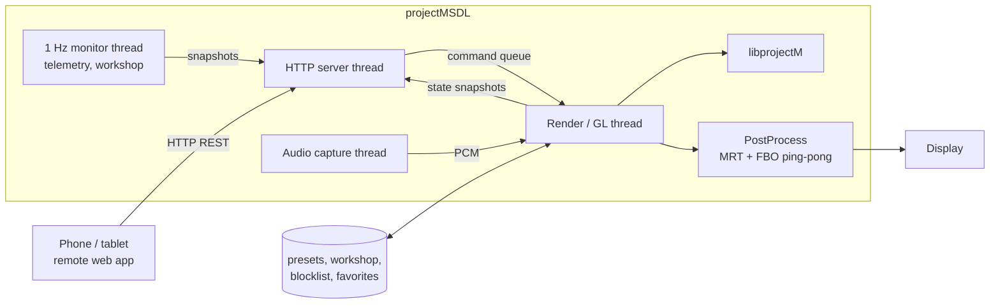

<h1> Dropkick</h1>

A [projectM](https://github.com/projectM-visualizer/projectm) audio visualizer
that runs on the **Raspberry Pi 5** (GLES 3.1) and on **Windows** (desktop
OpenGL 3.3), built to drive a TV over HDMI. A zero-dependency web app on your
LAN controls it from a phone, including a live Milkdrop preset editor.

## Engineering highlights

- **GLES 3.1 on Pi 5 (VideoCore VII).** Upstream projectM needs GLES 3.2. The
  frontend probes at runtime (3.2 → 3.1 → 3.0) and libprojectM accepts a 3.1 /
  GLSL ES 3.10 floor, so there is no hardcoded downgrade.
- **Single-pass post-processing.** Reduce-flashing persistence, brightness, and
  monochrome tint run as one MRT pass with FBO ping-pong, then `glBlitFramebuffer`
  to the backbuffer: no readback stall. Works on GLES 3.0+ and desktop GL 3.3 Core.
- **Quiet render loop.** Visual and auto-skip config are cached through
  property-change observers (no per-frame string lookups or hex parsing). The
  render thread publishes compact snapshots; JSON is serialized lazily on the
  HTTP thread.
- **Background telemetry.** CPU, memory, temperature, and workshop-folder polling
  run on a 1 Hz monitor thread (Linux `/proc` + `/sys`, Windows
  `GetSystemTimes` + `GlobalMemoryStatusEx`).
- **GPU-hang resilience.** A 4 s frame watchdog (checked when a frame returns), a
  breadcrumb that quarantines the preset that was active at the last crash or
  hang, persistent low-FPS strikes, and an optional hardware watchdog for
  full-board lockups.
- **Offline-first remote.** A dependency-free responsive web app (no CDN assets),
  an `ETag`/`304` preset catalog, constant-time token checks, atomic writes for
  favorites, slow-counts, and workshop files, and an inline preset editor with
  live apply.

## Architecture



Threading, the context fallback ladder, the post-process pipeline, the watchdog
layers, and the full HTTP API are in [docs/architecture.md](docs/architecture.md).

## Quick start

**Raspberry Pi 5** (Raspberry Pi OS, aarch64):

```bash
git clone https://github.com/s66lem/dropkick.git
cd dropkick && ./scripts/bootstrap.sh
dropkick
```

Bootstrap installs dependencies, builds the vendored libprojectM and frontend
with `-DENABLE_GLES=TRUE`, installs the `dropkick` launcher and a **Sound & Video**
menu entry, and creates the preset, texture, and workshop folders. Then open
`http://<pi-ip>:8080/op1` on a phone. Details: [docs/setup.md](docs/setup.md).

**Windows** (desktop OpenGL, built from source):

```powershell
powershell -ExecutionPolicy Bypass -File scripts\bootstrap.ps1
dropkick
```

See [docs/setup-windows.md](docs/setup-windows.md).

**Preview the remote UI with no build** (mock API on a local Node server):

```bash
node scripts/dev-remote.mjs
```

## Remote control & Workshop

The remote at `http://<host>:8080/<token>` has four views: **Now Playing**
(transport, shuffle, lock, favorite), **Browse** (search the whole library,
grouped by category), **Favorites**, and **Settings** (duration, transitions,
beat sensitivity, FPS, audio input, pack, Reduce flashing, brightness, tint).
It has dark and light themes, keyboard shortcuts, and chunked rendering for
large packs.

The Workshop edits Milkdrop `.milk` code in the browser. `Ctrl+Enter` applies it
to the TV live (via `workshop/_scratch.milk`); Save writes it to `workshop/`,
which also hot-reloads files edited on disk. See [docs/authoring.md](docs/authoring.md).

| Endpoint | Purpose |
|---|---|
| `GET /api/status` | Now playing, FPS, audio device, system telemetry |
| `GET /api/presets` | Library catalog (`ETag`, `304 Not Modified`) |
| `POST /api/next` `/prev` `/random` | Transport |
| `POST /api/settings` | Validated, clamped setting changes |
| `GET /api/audio/devices`, `POST /api/audio/select` | Audio input |
| `POST /api/workshop/apply`, `/save` | Live apply and save a preset |

Auth is the token, as the URL path (`/op1`), `?token=`, or the `X-Dropkick-Token`
header. The complete table is in [docs/architecture.md](docs/architecture.md#http-api).

## Keyboard shortcuts

On the visualizer window. `Ctrl` is `Cmd` on macOS.

| Key | Action |
|---|---|
| `N` / `P` or `Backspace` | Next / previous preset (previous is history-based) |
| `R` | Random preset |
| `Shift` + `N` / `P` / `R` | Same, with a hard cut |
| `Space` or `L` | Lock / unlock the current preset |
| `Y` | Toggle shuffle |
| `F` | Favorite / unfavorite the current preset |
| `Ctrl+F` or right-click | Toggle fullscreen |
| `Up` / `Down` | Beat sensitivity ±0.01 |
| `A` | Toggle aspect correction |
| `Ctrl+I` | Next audio input |
| `Ctrl+M` / `Ctrl+S` | Next display / stretch across monitors |
| `Ctrl+C` | Copy preset filename |
| `F1` | Help |
| `F3` / `F4` / `F5` | Preset name / playback stats / FPS |
| `Esc` | Toggle the menu bar |
| `Ctrl+Q` | Quit |

## Testing

C++ core unit tests (JSON utilities, preset lists, system monitor) via CMake/CTest:

```bash
cmake -S tests/cpp -B build/dropkick-core-tests
cmake --build build/dropkick-core-tests --config Debug
ctest --test-dir build/dropkick-core-tests -C Debug --output-on-failure
```

Remote tests:

```bash
node --test tests/remote/test_remote.mjs
```

The Node suite checks static UI constraints (for example no external assets) and
the mock HTTP API contract; it does not run the C++ server.

## Repository layout

- `external/` — vendored, patched libprojectM and projectMSDL frontend (no submodules)
- `remote/` — the remote web app (HTML/CSS/JS, no build step)
- `scripts/` — bootstrap, build, config sync, watchdog, blocklist seeding, `dev-remote.mjs`
- `config/` — `dropkick.env` and the `projectMSDL.properties` template
- `systemd/` — boot service unit
- `patches/` — exported copies of the GLES patches
- `tests/` — C++ core and remote tests
- `assets/` — project icon
- `docs/` — [architecture](docs/architecture.md), [setup](docs/setup.md), [Windows](docs/setup-windows.md), [presets](docs/presets.md), [authoring](docs/authoring.md), [patches](docs/patches.md)

## Credits & license

Dropkick is built on **[projectM](https://github.com/projectM-visualizer/projectm)**
and the **[projectM SDL frontend](https://github.com/projectM-visualizer/frontend-sdl2)**
by the projectM Team and contributors. The frontend is GPLv3 and libprojectM is
LGPL v2.1; Dropkick's own scripts, remote web app, systemd unit, and docs follow
suit. See `external/*/LICENSE*` for the upstream terms.
