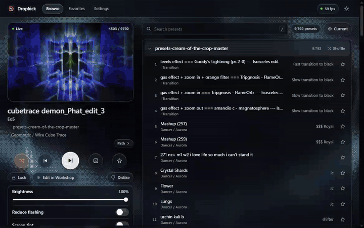
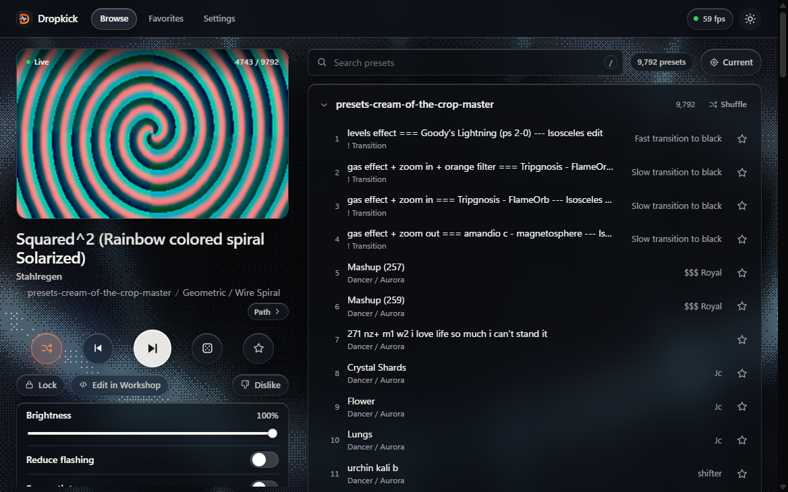
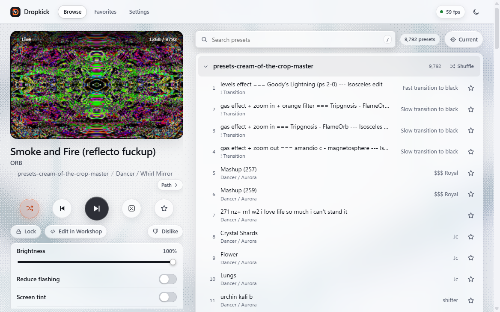
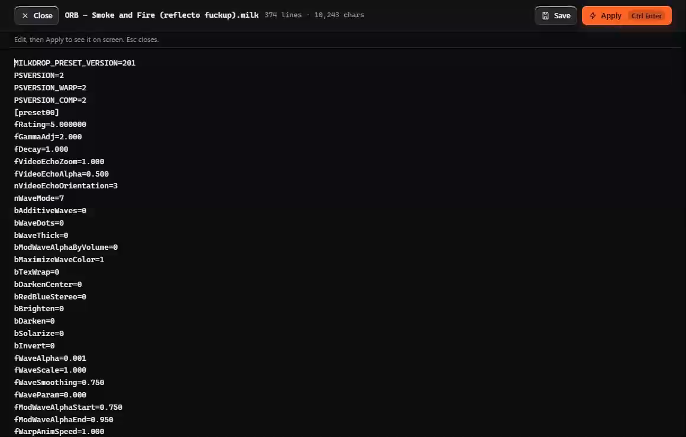
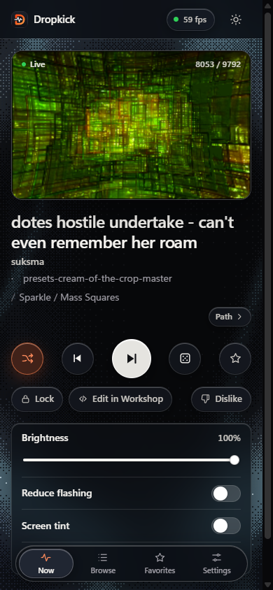
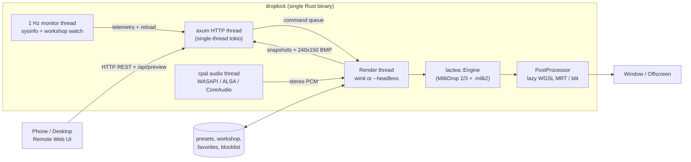

<p align="center">
  
</p>

<h1 align="center">Dropkick</h1>

<p align="center">
  Pure-Rust MilkDrop / projectM audio visualizer powered by
  <a href="https://crates.io/crates/lactea">Lactea</a> and
  <a href="https://wgpu.rs/">wgpu</a>, with an embedded LAN remote web app,
  live GPU preview, and browser preset workshop.
</p>

<p align="center">
  <a href="#quick-start">Quick start</a> ·
  <a href="#benchmarks">Benchmarks</a> ·
  <a href="#remote-ui--workshop">Remote UI</a> ·
  <a href="#architecture">Architecture</a> ·
  <a href="#cli--configuration">CLI</a> ·
  <a href="#testing">Testing</a>
</p>

<p align="center">
  
</p>

---

## Features

- **Single-binary Rust engine (`lactea 0.2.2` + `wgpu 30`).** Renders `.milk` and `.milk2` presets (MilkDrop 2/3 auto-compatibility) over Vulkan, DX12, Metal, or GLES with zero C++ runtime dependencies. Runs windowed, borderless fullscreen, or offscreen via `--headless`.
- **On-demand live preview (`/api/preview`).** Streams `240×150` 24-bit BMP frames straight from the GPU into the remote UI while a client is watching, without blocking the 60 fps render loop.
- **Lazy single-pass WGSL post-processing.** *Reduce flashing* (temporal persistence ping-pong), *Brightness*, and *Screen tint* run in one WGSL pass ([`src/postprocess.rs`](src/postprocess.rs)). Display and history textures are allocated only while an effect is enabled; otherwise the scene blits directly.
- **Cross-platform audio capture (`cpal`).** Enumerates Windows WASAPI output loopback and capture inputs with live hot-switching from the remote or keyboard ([`src/audio.rs`](src/audio.rs)).
- **Browser Remote UI & Workshop.** Zero-dependency HTML/CSS/JS served from disk or embedded directly in the binary ([`src/remote.rs`](src/remote.rs), [`remote/`](remote/)), featuring a Bayer 8×8 dithered background (dark and light themes), `ETag`/`304` catalog caching, and an inline `.milk` editor with live apply (`Ctrl+Enter`) and file hot-reload.
- **Crash & slow-preset resilience.** 4 s frame watchdog, startup crash-breadcrumb quarantine (`state/loading`), persistent low-FPS strikes, and atomic writes for favorites, dislikes, blocklists, and workshop files ([`src/state.rs`](src/state.rs), [`src/engine.rs`](src/engine.rs)).

<table>
  <tr>
    <td width="340" valign="middle">
      
    </td>
    <td valign="middle">
      <strong>Live Vulkan GPU rendering &amp; WGSL post-processing</strong>
      <br /><br />
      Captured directly from <code>GET /api/preview</code> on <code>dropkick</code>:
      soft transitions across <code>cream-of-the-crop</code> presets
      (<em>Squared^2</em>, <em>Smoke and Fire</em>, <em>cubetrace demon</em>)
      and real-time WGSL monochrome <code>Screen tint</code> toggled over HTTP.
    </td>
  </tr>
</table>

---

## Benchmarks

Measured with `target/release/dropkick.exe` against the 9,793-preset `cream-of-the-crop` pack on Windows (NVIDIA GeForce RTX 5080, Vulkan, `1280×720`):

| Metric | Result | Notes |
|---|---|---|
| **Preset parsing** | `9,793 / 9,793` (`100.0%`) | Full pack CPU parse + HLSL check in `3.32 s` |
| **HLSL → WGSL translation** | `9,781 / 9,793` (`99.88%`) | 8,249 presets with custom shaders; 12 shader errors |
| **Vulkan GPU render** | `237 / 238` (`99.58%`) | 0 shader fallbacks (1 source EEL syntax error) |
| **Uncapped GPU speed** | `441.5 fps` (`2.27 ms/frame`) | Averaged across 238 presets at `1280×720` |
| **Cold start (9,792 presets)** | `900 ms` avg (3 runs) | `536 ms` scan + HTTP ready; `364 ms` Vulkan + 1st BMP |
| **Binary & daemon footprint** | `10.26 MB` / `112.6 MB` RSS | Single stripped executable; `148.3 MB` private at boot |

---

## Remote UI & Workshop

Open `http://<host>:8080/` (or `http://<host>:8080/<token>` when `--token` / `remote.token` is set) on desktop or phone.

<table>
  <tr>
    <td width="50%" align="center" valign="bottom">
      <br />
      <sub><b>Desktop — Dark</b> · Live GPU plate + 9,792-preset Browse</sub>
    </td>
    <td width="50%" align="center" valign="bottom">
      <br />
      <sub><b>Desktop — Light</b> · Pearl/silver Bayer dither palette</sub>
    </td>
  </tr>
</table>

<table>
  <tr>
    <td width="77%" align="center" valign="bottom">
      <br />
      <sub><b>Workshop</b> · Inline <code>.milk</code> editor with <code>Ctrl+Enter</code> live apply</sub>
    </td>
    <td width="23%" align="center" valign="bottom">
      <br />
      <sub><b>Mobile</b> · Floating pill dock</sub>
    </td>
  </tr>
</table>

---

## Quick start

### Build & run (Rust)

Requires [Rust](https://rustup.rs/) (edition 2024).

```bash
git clone https://github.com/s66lem/dropkick.git
cd dropkick
cargo build --release
```

Run windowed with a preset directory:

```bash
./target/release/dropkick --presets /path/to/presets --port 8080
```

Run headless (offscreen GPU + LAN remote, no window required):

```bash
./target/release/dropkick --headless --presets /path/to/presets --port 8080
```

Preview the remote web app with no Rust build (mock Node API):

```bash
node scripts/dev-remote.mjs
```

<details>
<summary>Legacy C++ / Raspberry Pi 5 GLES 3.1 bootstrap</summary>

The vendored C++ projectM frontend and Pi 5 GLES 3.1 bootstrap scripts remain in `external/`, `scripts/`, and `patches/`. See [docs/setup.md](docs/setup.md) and [docs/setup-windows.md](docs/setup-windows.md).

</details>

---

## Architecture



Core modules under [`src/`](src/):

- [`src/main.rs`](src/main.rs) — `winit 0.30` windowed/fullscreen loop, `--headless` runner, `wgpu` backend selection (`Vulkan` default on Linux/Windows with DX12 fallback; `Metal` on macOS; `WGPU_BACKEND` override)
- [`src/engine.rs`](src/engine.rs) — `lactea::Engine` host, soft/hard transitions, auto-rotation, 4 s watchdog, low-FPS strikes
- [`src/postprocess.rs`](src/postprocess.rs) — lazy WGSL post-process pipeline and `240×150` preview staging readback
- [`src/remote.rs`](src/remote.rs) — single-threaded `axum` HTTP server, constant-time token auth, 1 MiB body cap, disk + embedded `remote/` serving
- [`src/state.rs`](src/state.rs) — playlist navigation, `ETag` revisioning, atomic persistence, startup crash-breadcrumb quarantine
- [`src/audio.rs`](src/audio.rs) — `cpal` stereo PCM capture & live device switching
- [`src/monitor.rs`](src/monitor.rs) — 1 Hz CPU/RAM/thermal telemetry & workshop folder watcher
- [`src/config.rs`](src/config.rs) & [`src/bmp.rs`](src/bmp.rs) — CLI / `projectMSDL.properties` loader, setting clamping, 24-bit BMP encoder

Legacy C++ threading, GLES 3.1 fallback, and full endpoint specs are documented in [docs/architecture.md](docs/architecture.md).

---

## CLI & configuration

Dropkick reads an optional `projectMSDL.properties` (via `--config <path>` or next to the executable) and overrides any value via CLI flags ([`src/config.rs`](src/config.rs)):

| Flag | Default | Description |
|---|---|---|
| `--presets <dir>` | `~/.local/share/dropkick/presets/cream-of-the-crop` | Active preset directory (`.milk`, `.milk2`) |
| `--preset-root <dir>` | `~/.local/share/dropkick/presets` | Root directory scanned for switchable packs |
| `--textures <dir>` | `~/.local/share/dropkick/textures` | Texture lookup directory |
| `--data-dir <dir>` | `~/.local/share/dropkick` | State directory (`favorites.json`, `blocklist.txt`, `workshop/`) |
| `--workshop-dir <dir>` | `<data-dir>/workshop` | Workshop save & hot-reload directory |
| `--web-root <dir>` | `./remote` (falls back to embedded assets) | Static web UI directory |
| `--host <addr>` | `0.0.0.0` | HTTP bind address |
| `--port <num>` | `8080` | HTTP bind port |
| `--token <str>` | *(empty = open)* | Auth token (`/<token>`, `?token=`, or `X-Dropkick-Token`) |
| `--width <px>` / `--height <px>` | `1280` / `720` | Render resolution |
| `--fps <num>` | `60` | Target frame rate (`10..240`) |
| `--fullscreen` | `false` | Start in borderless fullscreen |
| `--headless` | `false` | Offscreen GPU mode (no desktop window) |
| `--no-audio` | `false` | Disable audio capture |
| `--config <file>` | — | Load settings from a `.properties` file |

Set `WGPU_BACKEND=vulkan|dx12|metal|gl` to override automatic GPU backend selection.

---

## HTTP API & keyboard shortcuts

### Key endpoints

| Endpoint | Purpose |
|---|---|
| `GET /api/status` | Now playing, FPS, audio device, catalog revision, system telemetry |
| `GET /api/preview` | Live `240×150` 24-bit BMP (`204` when `livePreview=false`) |
| `GET /api/presets` | Full library catalog (`ETag` / `304 Not Modified`) |
| `POST /api/next` · `/prev` · `/random` · `/preset` | Transport (`prev` is history-based) |
| `GET` / `POST /api/settings` | Read or apply validated, clamped runtime settings |
| `GET /api/audio/devices`, `POST /api/audio/select` | List and hot-switch capture devices |
| `GET /api/workshop/source`, `POST /api/workshop/apply` · `/save` | Load, live-apply (`_scratch.milk`), and save presets (`409` conflict, `413` > 1 MiB) |

### Window keyboard shortcuts

| Key | Action |
|---|---|
| `N` / `P` or `Backspace` | Next / previous preset (history-based) |
| `R` | Random preset |
| `Shift` + `N` / `P` / `R` | Same, with a hard cut |
| `Space` or `L` | Lock / unlock current preset |
| `Y` | Toggle shuffle |
| `F` | Favorite / unfavorite current preset |
| `Ctrl+F` or right-click | Toggle borderless fullscreen |
| `Up` / `Down` | Beat sensitivity ±0.05 |
| `A` | Toggle aspect correction |
| `Ctrl+I` | Next audio input |
| `Ctrl+Q` | Quit |

---

## Testing

```bash
# Rust unit tests (BMP encoder, config clamping, atomic state & crash breadcrumb)
cargo test

# Remote UI static checks and mock API contract (29 tests)
node --test tests/remote/test_remote.mjs

# Live GPU end-to-end suite against the compiled release binary (9 suites)
cargo build --release && node tests/rust/e2e_dropkick.mjs
```

---

## Repository layout

- [`src/`](src/) — Rust visualizer, post-processor, audio capture, monitor, and HTTP remote server
- [`remote/`](remote/) — zero-dependency remote web app (HTML/CSS/JS + Bayer dither shader)
- [`assets/`](assets/) — app icon, live demo GIFs, and UI screenshots
- [`tests/`](tests/) — Rust GPU E2E suite ([`tests/rust/e2e_dropkick.mjs`](tests/rust/e2e_dropkick.mjs)), remote UI tests, and legacy C++ tests
- [`config/`](config/) & [`systemd/`](systemd/) — `projectMSDL.properties` template, env config, and boot service unit
- [`scripts/`](scripts/) — `dev-remote.mjs` mock server and legacy Pi/Windows bootstrap helpers
- [`docs/`](docs/) — [architecture](docs/architecture.md), [setup](docs/setup.md), [Windows](docs/setup-windows.md), [presets](docs/presets.md), [authoring](docs/authoring.md), [patches](docs/patches.md)

## Credits & license

The Rust engine builds on **[lactea](https://crates.io/crates/lactea)** and **[wgpu](https://wgpu.rs/)**. The vendored legacy C++ stack in `external/` is based on **[projectM](https://github.com/projectM-visualizer/projectm)** (LGPL v2.1) and **[frontend-sdl2](https://github.com/projectM-visualizer/frontend-sdl2)** (GPLv3). See [`Cargo.toml`](Cargo.toml) and `external/*/LICENSE*` for license details.
